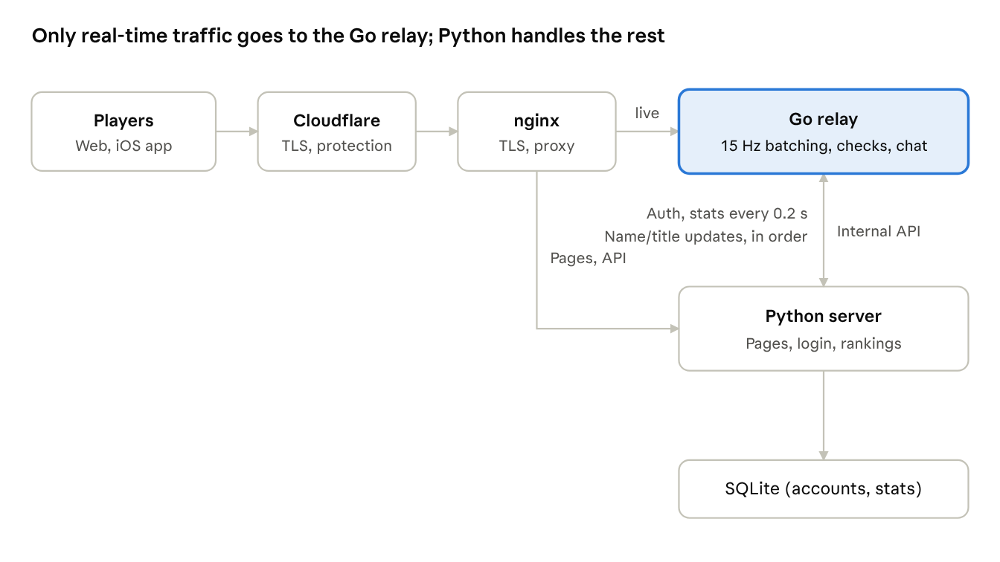
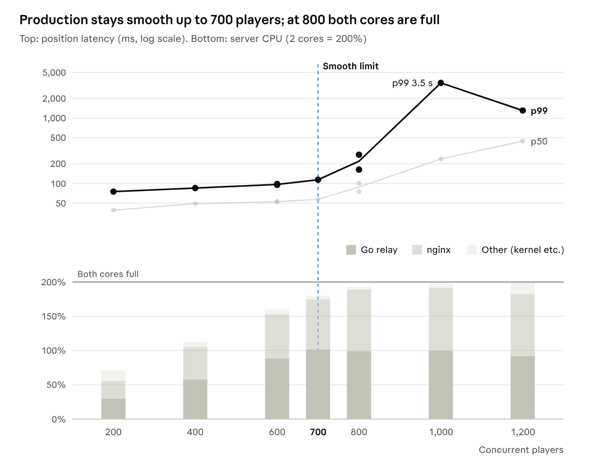

# Seolwongyeong Multiplayer Performance and Traffic Optimization Report

[한국어](README.md) | English

This report describes how the multiplayer server of **Seolwongyeong**, a ski metaverse ([ski.stelide.com](https://ski.stelide.com)), was load-tested and optimized. It was written on November 14, 2026. The Korean original is in [README.md](README.md).

**Research report** · [English PDF](paper/multiplayer-perf-report.en.pdf) · [한글 PDF](paper/multiplayer-perf-report.ko.pdf) · [LaTeX sources](paper/README.md)

## Contents

- [Summary](#summary)
- [Architecture](#architecture)
- [Method](#method)
- [Optimization steps](#optimization-steps)
  - [1. Send only changed fields](#1-send-only-changed-fields)
  - [2. File handle leak](#2-file-handle-leak)
  - [3. Connection limit of 2,000](#3-connection-limit-of-2000)
  - [4. The Python GIL and the Go relay](#4-the-python-gil-and-the-go-relay)
- [Production results (Nov 14)](#production-results-nov-14)
- [Pitfalls and limitations](#pitfalls-and-limitations)
- [Next steps](#next-steps)
- [License](#license)

## Summary

The production server for Seolwongyeong (Oracle Ampere, 2 cores) handles up to 700 concurrent players without falling behind. At 700 players the p99 position-delivery latency was 114 ms. At 800 the two cores were saturated, and from 1,000 the latency grew to several seconds. These numbers come from load tests run directly against production on November 14, 2026. They do not include TLS.

Four changes got us here.

| Change | Effect |
| --- | --- |
| Send only the fields that changed instead of the whole position | Bytes received per player down 56–60% |
| Close the DB connection that stayed open for every socket | Connection errors around 330 players went away |
| Raise the connection limits in the server, nginx and systemd to 2,000 | Configuration stopped being the bottleneck |
| Move only the real-time relay from Python to Go | Relay CPU per player down 2.2x (measured on STAGE) |

After the move to Go, nginx and kernel networking cost more than the relay itself. nginx uses about 40% of the production CPU. The next step is to serve `/ws` without nginx, and after that to reduce how much data each player receives.

## Architecture

The Go relay groups positions by room and sends them 15 times a second. Pages, login, rankings and the database stay in the Python server.

A slope channel room holds up to 40 players (the server-side cap is 48). Parties get their own room.

Every 1/15 s the server packs everyone in a room whose position changed into one frame and sends the same frame to the whole room. The first frame carries the full state (`u`), later frames carry only changed fields (`v`), and players who left are reported with `x`.

Positions that don't add up, such as moving too far in one step, are not relayed. Collisions are also decided on the server from speed and distance.

The server accepts up to 2,000 concurrent connections in total, with additional limits on connections per IP and message rate per connection. The old Python relay is still in place, so a single line of nginx config switches back to it.

## Method

All tests used a harness that connects fake players to the server. The first version was written in Python (`server/bench_net.py`). For the production test it was rewritten in Go so that two small machines could generate enough load.

Each fake player follows the same steps as the game client. It joins the lobby, announces which resort it is at, joins a slope channel room of 40, and sends its position 15 times a second. The position moves with the wall clock and the velocity field matches that movement, so the server's checks don't filter it out as invalid. Each player sends on a fixed grid (start + k/15 s) with its own random phase.

What we measured:

- Latency: one player per room (the probe) measures how long it takes for another player's position to reach it. Sender and probe run in the same process, so no clock sync is needed. The figure includes the server's 15 Hz batching wait (33 ms on average).
- Update rate: room updates the probe receives per second. 15 is normal.
- Bytes in and out per connection, counting WebSocket frame headers but not TCP/IP headers.
- Server CPU from `/proc`, per process (Go relay, Python, nginx), plus whole-system CPU on production. One core is 100%.
- Dropped connections and failed room joins.

Three environments:

| Environment | CPU | Server and harness | Used for |
| --- | --- | --- | --- |
| Production (Nov 14) | Ampere, 2 cores | Harness on two other servers (STAGE and the bot server), over the real network and nginx | Real capacity |
| Ubuntu i5-11600K (Nov 11) | Server pinned to 2 cores | Same machine, separate cores | Python server limit |
| STAGE (Nov 11) | Ampere, 1 core | Server and harness share the core | Comparing the two implementations under identical conditions |

For the production test we opened a temporary path that only the two harness machines could reach, and closed it afterwards. Fake players used channels that real players don't use. Each step had an 8 s warm-up followed by a 30 s measurement.

## Optimization steps

The bottleneck moved from bandwidth, to file handles, to the Python GIL, to nginx and networking.

### 1. Send only changed fields

The server used to send every player's full position on every tick. It now sends the full state once (`u`) and only changed fields after that (`v`). Compared on STAGE with one core:

| Players | Received per player (KB/s, before → after) | Server send (MB/s, before → after) |
| --- | --- | --- |
| 50 | 62.5 → 27.6 | 3.05 → 1.35 |
| 100 | 65.3 → 28.9 | 6.38 → 2.82 |
| 200 | 70.8 → 28.4 | 13.83 → 5.54 |
| 400 | 54.5 → 23.4 | 21.30 → 9.14 |

Bytes received and bytes sent both fell 56–60%. CPU stayed about the same: this cut bandwidth, not server work.

### 2. File handle leak

During testing, `/ws` started returning 500 at around 330 players. The function that handles a socket doesn't return until the socket closes, and an SQLite connection opened inside it stayed open the whole time. Each connection held three files, which hit the default limit of 1,024. After closing the DB connection right away, each connection holds only its socket: 104 files at 100 players instead of 305.

### 3. Connection limit of 2,000

We raised the server's connection limit from 400 to 2,000, nginx `worker_connections` to 8,192, and `LimitNOFILE` for each service to 65,536. From then on CPU, not configuration, set the limit.

### 4. The Python GIL and the Go relay

With the Python server pinned to two cores on the Ubuntu machine, CPU stopped climbing at 125–133%. Because of the GIL, Python runs Python code on one thread at a time. A second core bought only about 25%.

| Players | Server CPU (2 cores = 200%) | Updates/s | Latency p50 / p99 (ms) |
| --- | --- | --- | --- |
| 400 | 47% | 14.5 | 40 / 74 |
| 800 | 100% | 13.6 | 49 / 91 |
| 1,000 | 133% | 11.8 | 55 / 103 |
| 1,200 | 125% | 7.8 | 161 / 237 |

Adjusting for the speed difference between that machine and a production core (about 1.75x), we estimated that Python on production would stay smooth up to about 450 players and start struggling around 570.

So we moved only the real-time relay (rooms, position batching, relay checks, chat, parties) to Go. Pages, login, rankings and the database stayed in Python. The two compared on the same one-core STAGE machine:

| Players | Python (updates/s, p99) | Go (updates/s, p99) | Server CPU (Python → Go) |
| --- | --- | --- | --- |
| 100 | 14.5, 71 ms | 15.0, 71 ms | 19% → 11% |
| 200 | 14.0, 77 ms | 15.0, 74 ms | 37% → 19% |
| 400 | 10.8, 296 ms | 15.0, 78 ms | 63% → 33% |
| 800 | 8.0, 725 ms | 15.0, 325 ms | 71% → 48% |

CPU per player was 0.185% for Python and 0.083% for Go, about 2.2x less. The higher Go latency at 800 comes from sharing STAGE's single core with the harness. The Go relay has been running in production since November 12.

## Production results (Nov 14)

With the Go relay, production stayed smooth up to 700 players (p99 114 ms, 15 updates/s). At 800 total CPU reached 189–197%, and from 1,000 the p99 jumped to seconds.

| Players | Updates/s | Latency p50 / p99 (ms) | Total CPU (of 200%) | Go relay | nginx |
| --- | --- | --- | --- | --- | --- |
| 200 | 15.0 | 39 / 75 | 71% | 30% | 26% |
| 400 | 15.0 | 49 / 85 | 113% | 58% | 47% |
| 600 | 15.0 | 52–53 / 95–98 | 158–161% | 87–90% | 63–65% |
| 700 | 15.0 | 57 / 114 | 180% | 101% | 73% |
| 800 | 15.0 | 75–101 / 163–275 | 189–197% | 90–108% | 87–94% |
| 1,000 | 12.7 | 237 / 3,467 | 197% | 100% | 91% |
| 1,200 | 14.3 | 445 / 1,309 | 200% | 92% | 91% |

600 and 800 were each measured twice and are shown as ranges. The bars in the chart are the average of the two runs.

No connection was dropped and no room join was refused at any step. Past the limit the server sends late instead of disconnecting. From 800 players, though, bytes received per player fell 13–21%, and above 1,000 they fell to about half.

Per player, the Go relay costs about 0.14% CPU and nginx about 0.10%. The rest is kernel networking. nginx costs roughly 70% as much as the relay itself.

The Python server sat at 0–1%. The fake players were guests, so there were no login checks or stats to forward. The two harness machines were at 66–72% CPU even at 1,200 players, so the limit was on the server side.

Compared with the 450-player estimate for Python, the smooth limit grew about 1.5x. The relay itself got 2.2x lighter, but the nginx and kernel costs didn't change, so capacity grew by less.

## Pitfalls and limitations

If the harness measures badly, you end up measuring the harness instead of the server. These are the problems we actually ran into.

At first each fake player sent, then slept 1/15 s. They all drifted to just after the server tick and sent at the same moment, which inflated latency to 61 ms. Sending on a fixed grid with a random phase per player fixed it. Real players are on different devices and don't line up like that.

On a single core the harness used more CPU than the Go relay. The Python harness topped out at about 300 players per one-core machine. We rewrote it in Go for the production test, and one machine could then drive about 650 players.

Numbers measured within one machine come out too low. On STAGE, with server and harness on the same machine, the Go relay used 0.083% per player. In production, over a real network, it was 0.14%, close to double. Same-machine numbers are fine for comparing two implementations but shouldn't be used to estimate capacity.

At low player counts fixed costs make the per-player cost look high. Per-player figures are computed from runs with 200 or more players.

What this test doesn't cover:

- The production test reached nginx over plain HTTP. Real players go through Cloudflare and TLS, so the real limit is likely below 700.
- Fake players ride nonstop and every room is full at 40. Real players don't send positions from the menu or lift-ticket screens, and rooms are rarely full. In that respect the test is heavier than real play.
- Most steps were measured once. At 800, two runs gave p99 of 163 ms and 275 ms. Near the limit, small differences swing the results a lot.
- Collision handling was verified only by server tests. Position sync, chat and parties were checked in the actual game.

## Next steps

Real concurrency is still in the single digits, so 700 leaves plenty of room. Nothing needs to change yet. As traffic grows, the plan is:

1. Serve `/ws` without nginx. A Cloudflare Origin Rule sends only `/ws` to the Go relay on a different port, and Go handles TLS itself. Players' URLs and the iOS app stay the same. Removing nginx's share (about 40% of CPU) should allow roughly 900–1,000 players. In exchange, the Go relay has to take over per-IP connection rate limits, slow-connection protection, reading the real IP from `CF-Connecting-IP`, and certificate handling. We haven't yet checked whether Origin Rules are available on the free plan.
2. Send less data. Trimming decimal places should cut bytes by 20–30% with few code changes. Dropping from 15 Hz to 10 Hz cuts both frame count and bytes by a third, but we need to check that remote players still look smooth. Varying the send rate by distance could cut bytes by 50–70%, but each recipient then needs its own frame, so whether CPU actually drops has to be measured. Any of these has to keep accepting the current format used by the shipped iOS app and the bot server.
3. As a last step, pay for more cores on the production server.

Options we considered and rejected:

| Option | Why not |
| --- | --- |
| Move the whole server to Go | The only bottleneck is the real-time relay; pages and the API are light |
| Move the relay to STAGE (1 core) | Smooth capacity would drop to about 450–550, and we'd lose our test server |
| Split the relay across three servers | Lobby, parties and chat would need constant syncing between relays; too much complexity for the gain |
| WebSocket compression (permessage-deflate) | Fewer bytes, but more CPU, which is the current bottleneck |

Still to measure: capacity over the real TLS path, and a rerun after step 1.

## License

This report is licensed under [CC BY 4.0](LICENSE).
