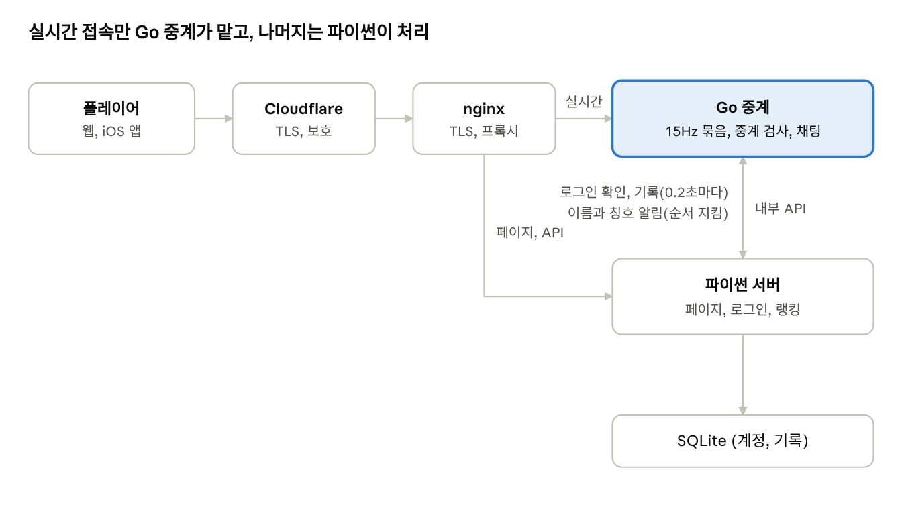
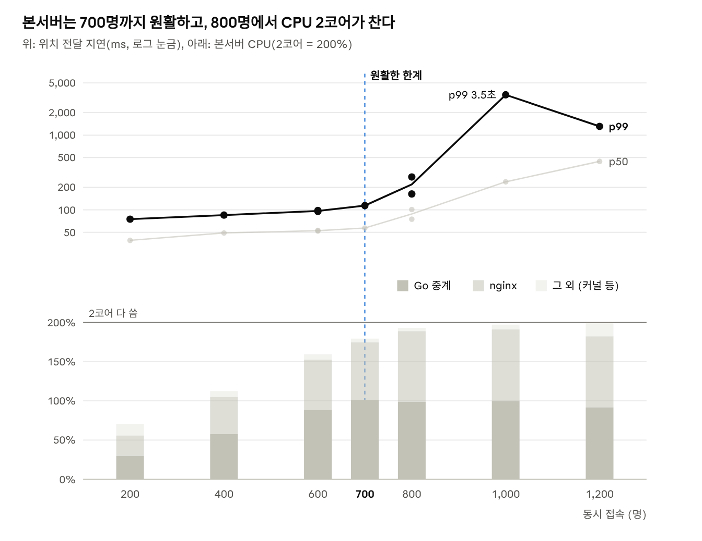

# 설원경 멀티플레이 성능 및 트래픽 최적화 보고서

[English](README.en.md)

2026년 11월 14일

## 요약

설원경 본서버(Oracle Ampere 2코어)는 동시 접속 700명까지 지연 없이 버틴다. 700명에서 위치 전달 지연 p99는 114ms였다. 800명에서 CPU 2코어가 다 찼고, 1,000명부터는 지연이 초 단위로 늘었다. 2026년 11월 14일 본서버에 직접 부하를 걸어 잰 값이고, TLS 비용은 빠져 있다.

여기까지 오는 동안 한 일은 네 가지다.

| 한 일 | 결과 |
| --- | --- |
| 위치를 통째로 보내지 않고 바뀐 칸만 보냄 | 한 명이 받는 양 56\~60% 감소 |
| 접속마다 열린 채 남던 DB 연결을 닫음 | 330명 근처에서 나던 접속 오류가 사라짐 |
| 서버, nginx, systemd의 접속 한도를 2,000명으로 올림 | 설정값이 병목에서 빠짐 |
| 실시간 중계만 파이썬에서 Go로 옮김 | 한 명당 중계 CPU가 2.2배 줄어듦 (STAGE 기준) |

Go로 옮긴 뒤에는 중계 프로그램보다 nginx와 커널 네트워크 처리가 더 큰 비용이 됐다. 본서버 CPU의 약 40%를 nginx가 쓴다. 다음 순서는 `/ws`를 nginx 없이 받는 것이고, 그래도 모자라면 보내는 양을 줄인다.

## 시스템 구조

실시간 위치는 Go 중계가 방 단위로 모아 초당 15번 보낸다. 페이지, 로그인, 랭킹, DB는 파이썬 서버가 맡는다.

슬로프 채널 방 하나에는 40명까지 들어간다(서버 쪽 상한은 48명). 파티는 따로 방을 쓴다.

서버는 1/15초마다 방 안에서 위치가 바뀐 사람들을 한 프레임으로 묶어 방 전원에게 같은 프레임을 보낸다. 처음 한 번은 전체 상태(`u`)를, 그다음부터는 바뀐 칸(`v`)만 보내고, 나간 사람은 `x`로 알린다.

한 번에 너무 멀리 움직이는 것처럼 앞뒤가 안 맞는 위치는 중계하지 않는다. 부딪힘도 서버가 속도와 거리를 보고 판정한다.

서버 전체 동시 접속은 2,000명까지 받는다. IP당 접속 수와 접속당 메시지 속도에도 제한이 있다. 예전 파이썬 중계는 지우지 않고 남겨 두어서, 문제가 생기면 nginx 설정 한 줄로 되돌릴 수 있다.

## 측정 방법

가짜 플레이어를 만들어 서버에 붙이는 하네스로 쟀다. 파이썬으로 먼저 만들었고(`server/bench_net.py`), 본서버를 잴 때는 부하를 더 많이 내려고 Go로 다시 만들었다.

가짜 플레이어는 게임 엔진과 같은 순서로 움직인다. 로비에 들어가 어느 스키장에서 타는지 알리고, 슬로프 채널 방(40명)에 들어간 뒤 초당 15번 위치를 보낸다. 위치는 실제 시계를 따라 바뀌고 속도 값도 그 움직임에 맞춘다. 서버 검사가 이상한 움직임으로 보고 걸러내지 않게 하려는 것이다. 보내는 시점은 사람마다 위상을 다르게 잡은 고정 간격(시작 + k/15초)이다.

잰 항목은 다음과 같다.

- 지연: 방마다 한 명(probe)이 다른 사람이 보낸 위치가 자기에게 오기까지의 시간을 잰다. 보낸 쪽과 받는 쪽이 같은 프로세스라 시계를 맞출 필요가 없다. 서버가 15Hz로 모아 보내는 대기 시간(평균 33ms)이 포함된다.
- 갱신 횟수: probe가 1초에 받은 방 갱신 수. 정상이면 15다.
- 주고받은 양: 접속마다 WebSocket 프레임 헤더까지 센다. TCP/IP 헤더는 뺐다.
- 서버 CPU: `/proc`에서 Go 중계, 파이썬, nginx를 따로 재고, 본서버에서는 시스템 전체도 쟀다. 코어 하나를 100%로 친다.
- 끊긴 접속과 방에 못 들어간 수.

측정 환경은 세 곳이다.

| 환경 | CPU | 서버와 하네스 | 용도 |
| --- | --- | --- | --- |
| 본서버 (11월 14일) | Ampere 2코어 | 다른 서버 두 대(STAGE, 봇 서버)에서 실제 네트워크와 nginx를 거쳐 접속 | 실제 한계 |
| Ubuntu i5-11600K (11월 11일) | 서버를 2코어에 묶음 | 같은 컴퓨터, 다른 코어 | 파이썬 서버의 한계 |
| STAGE (11월 11일) | Ampere 1코어 | 같은 코어를 나눠 씀 | 같은 조건에서 두 구현 비교 |

본서버를 잴 때는 하네스 두 대만 들어올 수 있는 임시 경로를 열었다가 끝나고 닫았다. 가짜 플레이어는 실제 플레이어가 쓰지 않는 채널에만 들어갔다. 단계마다 8초 예열 후 30초를 쟀다.

## 최적화 과정

병목은 대역폭, 파일 핸들, 파이썬 GIL, nginx와 네트워크 순으로 옮겨 갔다.

### 1. 바뀐 칸만 보내기

예전에는 매번 위치 전체를 보냈다. 이것을 처음 한 번만 전체(`u`)를 보내고 이후에는 바뀐 칸(`v`)만 보내도록 바꿨다. STAGE 1코어에서 같은 조건으로 비교했다.

| 동시 접속 | 한 명이 받는 양 (KB/s, 전 → 후) | 서버 송신 (MB/s, 전 → 후) |
| --- | --- | --- |
| 50 | 62.5 → 27.6 | 3.05 → 1.35 |
| 100 | 65.3 → 28.9 | 6.38 → 2.82 |
| 200 | 70.8 → 28.4 | 13.83 → 5.54 |
| 400 | 54.5 → 23.4 | 21.30 → 9.14 |

받는 양과 서버 송신이 56\~60% 줄었다. CPU 사용량은 거의 그대로였다. 대역폭은 줄었지만 서버가 하는 계산은 줄지 않았다는 뜻이다.

### 2. 파일 핸들 누수

측정 중 약 330명에서 `/ws`가 500 오류를 냈다. 접속을 처리하는 함수는 접속이 끝날 때까지 반환하지 않는데, 그 안에서 연 SQLite 연결이 닫히지 않고 남아 있었다. 접속 하나가 파일을 3개씩 쥐고 있었고, 기본 한도 1,024개에 걸린 것이다. 연결을 바로 닫게 고친 뒤로는 접속마다 소켓 하나만 쓴다. 100명 기준 305개에서 104개로 줄었다.

### 3. 접속 한도 2,000명

서버의 동시 접속 한도를 400에서 2,000으로, nginx `worker_connections`를 8,192로, 서비스별 `LimitNOFILE`을 65,536으로 올렸다. 이후로는 설정값이 아니라 CPU가 한계가 됐다.

### 4. 파이썬 GIL과 Go 중계

Ubuntu 컴퓨터에서 파이썬 서버를 2코어에 묶어 재 보니 CPU가 125\~133%에서 더 올라가지 않았다. 파이썬은 GIL 때문에 파이썬 코드를 한 번에 한 스레드만 실행한다. 코어를 하나 더 줘도 얻는 것은 25% 정도였다.

| 동시 접속 | 서버 CPU (2코어 = 200%) | 초당 갱신 | 지연 p50 / p99 (ms) |
| --- | --- | --- | --- |
| 400 | 47% | 14.5 | 40 / 74 |
| 800 | 100% | 13.6 | 49 / 91 |
| 1,000 | 133% | 11.8 | 55 / 103 |
| 1,200 | 125% | 7.8 | 161 / 237 |

이 컴퓨터와 본서버의 코어 속도 차이(약 1.75배)를 반영하면, 파이썬 본서버는 450명 정도까지 원활하고 570명 정도에서 버티기 어려워진다고 추정했다.

그래서 실시간 중계(방 관리, 위치 묶음, 중계 검사, 채팅, 파티)만 Go로 옮겼다. 페이지, 로그인, 랭킹, DB는 파이썬에 그대로 두었다. 같은 STAGE 1코어에서 둘을 비교한 결과는 아래와 같다.

| 동시 접속 | 파이썬 (초당 갱신, p99) | Go (초당 갱신, p99) | 서버 CPU (파이썬 → Go) |
| --- | --- | --- | --- |
| 100 | 14.5, 71ms | 15.0, 71ms | 19% → 11% |
| 200 | 14.0, 77ms | 15.0, 74ms | 37% → 19% |
| 400 | 10.8, 296ms | 15.0, 78ms | 63% → 33% |
| 800 | 8.0, 725ms | 15.0, 325ms | 71% → 48% |

한 명당 CPU는 파이썬 0.185%, Go 0.083%로 약 2.2배 차이가 났다. 800명에서 Go의 지연이 늘어난 것은 STAGE의 코어 하나를 하네스와 나눠 썼기 때문이다. Go 중계는 11월 12일부터 본서버에서 돌고 있다.

## 본서버 실측 (11월 14일)

Go 중계로 바꾼 본서버는 700명까지 원활했다(p99 114ms, 초당 갱신 15). 800명에서 CPU 합계가 189\~197%까지 올랐고, 1,000명부터는 p99가 초 단위로 뛰었다.

| 동시 접속 | 초당 갱신 | 지연 p50 / p99 (ms) | 서버 CPU 합계 (200% 만점) | Go 중계 | nginx |
| --- | --- | --- | --- | --- | --- |
| 200 | 15.0 | 39 / 75 | 71% | 30% | 26% |
| 400 | 15.0 | 49 / 85 | 113% | 58% | 47% |
| 600 | 15.0 | 52\~53 / 95\~98 | 158\~161% | 87\~90% | 63\~65% |
| 700 | 15.0 | 57 / 114 | 180% | 101% | 73% |
| 800 | 15.0 | 75\~101 / 163\~275 | 189\~197% | 90\~108% | 87\~94% |
| 1,000 | 12.7 | 237 / 3,467 | 197% | 100% | 91% |
| 1,200 | 14.3 | 445 / 1,309 | 200% | 92% | 91% |

600명과 800명은 두 번 쟀고 범위로 적었다. 그래프의 막대는 두 번의 평균이다.

어느 단계에서도 접속이 끊기거나 방 입장이 거절되지는 않았다. 한계를 넘으면 서버는 접속을 끊지 않고 늦게 보낸다. 그 대신 800명부터 한 명이 받는 양이 13\~21% 줄었고, 1,000명 이상에서는 절반 가까이로 줄었다.

한 명당 비용은 Go 중계가 약 0.14%, nginx가 약 0.10%였다. 나머지는 커널의 네트워크 처리다. nginx가 중계 프로그램의 70% 정도를 더 쓰는 셈이다.

파이썬 서버는 0\~1%로 거의 일하지 않았다. 가짜 플레이어가 게스트라 로그인 확인과 기록 전달이 없었기 때문이다. 하네스 두 대의 CPU는 1,200명에서도 66\~72%여서, 한계는 하네스가 아니라 서버 쪽이었다.

파이썬일 때 추정한 450명과 비교하면 원활한 한계가 1.5배 정도 늘었다. 중계 자체는 2.2배 가벼워졌지만 nginx와 커널 비용은 그대로 남았기 때문에 그만큼은 늘지 않았다.

## 측정하면서 겪은 문제와 한계

하네스가 잘못 재면 서버가 아니라 하네스를 재게 된다. 실제로 겪은 문제는 이렇다.

처음에는 가짜 플레이어가 "보내고 1/15초 쉬기"를 반복했다. 그러자 모두 서버 틱 직후로 몰려 같은 순간에 보냈고, 지연이 61ms로 부풀려졌다. 사람마다 위상이 다른 고정 간격으로 보내게 바꿔서 해결했다. 실제 플레이어는 서로 다른 기기라 이렇게 몰리지 않는다.

같은 1코어에서는 하네스가 Go 중계보다 CPU를 더 썼다. 파이썬 하네스는 1코어 한 대로 300명 정도가 한계였다. 본서버를 재려고 하네스를 Go로 다시 만들었고, 한 대로 650명 정도까지 보낼 수 있었다.

같은 컴퓨터 안에서 잰 숫자는 실제보다 작게 나온다. STAGE에서 서버와 하네스가 같은 컴퓨터 안에서 주고받을 때 Go 중계의 한 명당 CPU는 0.083%였는데, 실제 네트워크를 타는 본서버에서는 0.14%로 두 배 가까이 됐다. 같은 컴퓨터 안의 숫자는 두 구현을 비교할 때만 쓰고, 한계 인원을 추정할 때는 쓰지 않는 것이 맞다.

인원이 적을 때는 고정 비용 때문에 한 명당 비용이 커 보인다. 한 명당 비용은 200명 이상의 결과로 계산했다.

이번 측정에서 부족한 점도 있다.

- 본서버 측정은 nginx까지 평문(http)으로 들어갔다. 실제 플레이어는 Cloudflare와 TLS를 거치므로 실제 한계는 700명보다 낮을 것이다.
- 가짜 플레이어는 쉬지 않고 탔고 방은 항상 40명이 찼다. 실제로는 메뉴나 리프트권 화면에서는 위치를 보내지 않고 방도 덜 찬다. 이 점에서는 실제보다 무거운 조건이다.
- 대부분의 단계는 한 번만 쟀다. 800명은 두 번의 p99가 163ms와 275ms로 차이가 컸다. 한계 근처에서는 작은 차이에도 결과가 크게 흔들린다.
- 부딪힘 판정은 서버 테스트로만 확인했다. 위치 전달, 채팅, 파티는 실제 게임 화면으로 확인했다.

## 앞으로의 계획

지금 실제 동시 접속은 몇 명 수준이라 700명까지는 여유가 충분하다. 당장 바꿀 것은 없고, 접속이 늘면 아래 순서로 대응한다.

1. `/ws`를 nginx 없이 받는다. Cloudflare Origin Rules로 `/ws`만 다른 포트의 Go 중계로 보내고, TLS는 Go가 직접 처리한다. 플레이어가 접속하는 주소와 iOS 앱은 바꿀 필요가 없다. nginx가 쓰던 CPU 약 40%가 빠지므로 900\~1,000명 정도를 기대한다. 대신 IP당 접속 속도 제한, 느린 연결 차단, `CF-Connecting-IP`로 실제 IP 읽기, 인증서 관리를 Go 쪽에서 해야 한다. 무료 요금제에서 Origin Rules를 쓸 수 있는지는 아직 확인하지 않았다.
2. 보내는 양을 줄인다. 숫자 자릿수를 줄이면 바이트가 20\~30% 줄 것으로 보고, 고칠 곳도 적다. 15Hz를 10Hz로 내리면 보내는 횟수와 바이트가 모두 1/3 줄지만, 화면이 덜 부드러워지는지 먼저 봐야 한다. 거리에 따라 보내는 빈도를 달리하면 바이트가 50\~70% 줄 수 있지만, 받는 사람마다 프레임을 따로 만들어야 해서 CPU가 실제로 줄어드는지는 재 봐야 안다. 어느 방법이든 이미 배포된 iOS 앱과 봇 서버가 쓰는 지금 형식도 계속 받아야 한다.
3. 마지막으로 유료로 본서버 코어를 늘린다.

검토했지만 하지 않기로 한 방법도 있다.

| 방법 | 하지 않은 이유 |
| --- | --- |
| 서버 전체를 Go로 옮기기 | 병목은 실시간 중계뿐이고 페이지와 API는 부하가 작다 |
| 중계를 STAGE(1코어)로 옮기기 | 원활한 한계가 450\~550명으로 오히려 줄고, 시험 서버가 없어진다 |
| 서버 세 대에 중계를 나눠 두기 | 로비, 파티, 채팅을 세 중계가 계속 맞춰야 해서 얻는 것에 비해 복잡하다 |
| WebSocket 압축(permessage-deflate) | 바이트는 줄지만 CPU를 더 써서 지금의 병목을 키운다 |

아직 남은 측정은 TLS가 포함된 실제 경로에서의 한계 인원, 그리고 1번을 적용한 뒤의 재측정이다.
